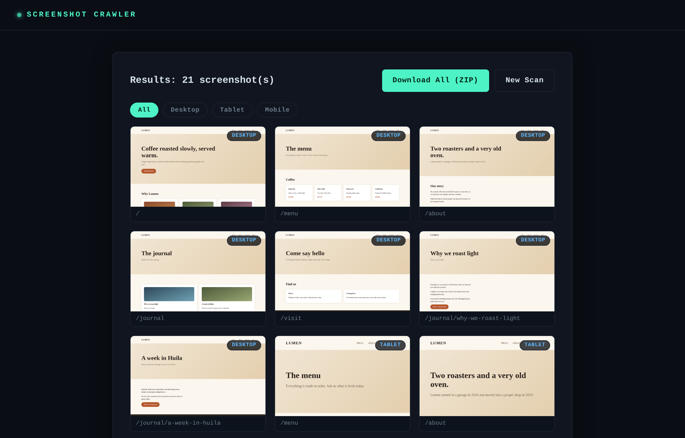
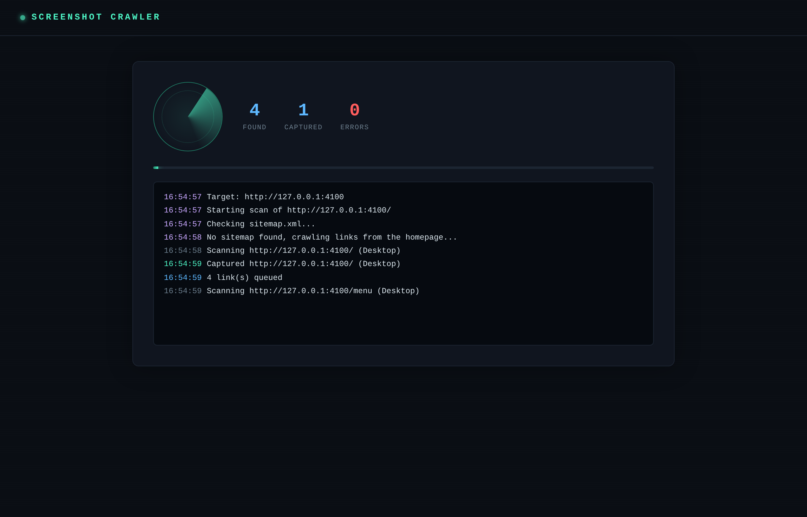

# Website Screenshot Crawler

[](https://github.com/JackB2003/website-screenshot-crawler/actions/workflows/ci.yml)
[](LICENSE)
[](package.json)

**Capture full-page screenshots of every page on a website from a single URL.** Enter an address and the crawler finds the pages itself, using the sitemap when there is one and a real-browser link crawl when there is not. It shoots each page at desktop, tablet and mobile sizes, streams progress live, and hands you a gallery and a ZIP.

Self-hosted and free. No account, no API key, no per-screenshot fee. Run it on your own computer or your own server.



## Why use it

- **You do not list the pages.** Most screenshot tools capture one URL per request. This one discovers the whole site.
- **Responsive in one scan.** Desktop (1440x900), tablet (768x1024) and mobile (375x812). Discovery runs once and the other sizes reuse the page list.
- **Works on modern sites.** Pages are rendered in Chromium through Playwright, so JavaScript-built sites, single-page apps and lazy-loaded images come out right.
- **Secure by default.** It will not fetch internal addresses, listens on localhost only, and can sit behind a password. See [Security](#security).
- **Good for:** design review, QA across breakpoints, client handoffs, before-and-after comparisons, content inventories, and archiving a site.

## Quick start

You need [Node.js](https://nodejs.org) 20 or newer. Then run one command:

```bash
npx github:JackB2003/website-screenshot-crawler
```

The first run downloads the Chromium browser it needs (about 130 MB) and installs the app. When it is ready it opens <http://localhost:3012> in your browser. Enter a URL, choose your device sizes and press **Start Scan**. Press Ctrl+C in the terminal to stop it.

Options:

| Option | What it does |
|---|---|
| `--port 8080` | Use a different port. By default it uses 3012, or the next free one. |
| `--allow-private` | Allow scanning `localhost` and private network sites. See [below](#scanning-a-site-on-your-own-machine). |
| `--no-open` | Do not open the browser automatically. |
| `--no-sandbox` | Start Chromium without its sandbox, for some containers and servers. |

Example: `npx github:JackB2003/website-screenshot-crawler --port 8080 --no-open`

### Install from source

If you want to change the code, or run it as a long-lived service:

```bash
git clone https://github.com/JackB2003/website-screenshot-crawler.git
cd website-screenshot-crawler
npm install
npx playwright install --only-shell chromium
npm start
```

### Try it on the included demo site

No site handy? The repo ships with a small sample site:

```bash
npm run demo-site                       # terminal 1: serves http://127.0.0.1:4100
npx . --allow-private                   # terminal 2 (or: ALLOW_PRIVATE_URLS=true npm start)
```

Then scan `http://127.0.0.1:4100`.

### Scanning a site on your own machine

Local and private addresses are blocked by default (see [Security](#security)). To scan a dev server on `localhost` or a site on your home network, turn private scanning on for your own machine:

```bash
npx github:JackB2003/website-screenshot-crawler --allow-private
```

(From a source checkout: `ALLOW_PRIVATE_URLS=true npm start`.)

Then scan `http://localhost:3000` or `http://192.168.1.50:5173`. Include the `http://` so the address is not upgraded to `https://`. Do not turn this on for a server other people can reach.

### Docker

```bash
docker compose up --build
```

The container listens on <http://localhost:3012> only. Copy `.env.example` to `.env` to change settings. The Docker setup has not been tested on every platform, so please open an issue if something does not work.

## Running it on a server

Bind to a network address and set a token. The app refuses to start on a non-local address without one.

```bash
HOST=0.0.0.0 AUTH_TOKEN="$(openssl rand -hex 24)" npm start
```

Browsers show a login prompt: use any username and the token as the password. Scripts can send `Authorization: Bearer <token>`. Put it behind HTTPS (Caddy, nginx, or a Cloudflare Tunnel) so the token is not sent in the clear. If you use a reverse proxy, set `TRUST_PROXY=true` so rate limits see real client addresses.

If Chromium fails with "sandboxing failed" (common inside containers and some VPS images), set `CHROMIUM_SANDBOX=false`. The network protections below do not depend on the sandbox, but the sandbox is an extra layer, so leave it on when you can.

## Configuration

Everything is an environment variable. All are optional.

| Variable | Default | What it does |
|---|---|---|
| `PORT` | `3012` | Port to listen on. |
| `HOST` | `127.0.0.1` | Address to listen on. Anything other than localhost requires `AUTH_TOKEN`. |
| `AUTH_TOKEN` | none | Shared password for the UI and API. |
| `ALLOW_UNAUTHENTICATED` | `false` | Skip the token requirement on a network address, for when another layer handles access. |
| `ALLOW_PRIVATE_URLS` | `false` | Allow scanning localhost, LAN and other private addresses. |
| `ALLOW_INVALID_CERTS` | `false` | Accept invalid or self-signed HTTPS certificates. |
| `MAX_PAGES_LIMIT` | `200` | Highest page count a single scan may request. |
| `MAX_CONCURRENT_SCANS` | `2` | Scans that may run at once. Extra requests get a 429. |
| `SCANS_PER_HOUR_PER_CLIENT` | `20` | Scans one client address may start per hour. |
| `SCAN_TIMEOUT_MINUTES` | `30` | A scan stops and keeps what it has after this long. |
| `MAX_STORED_JOBS` | `50` | Finished scans kept on disk before the oldest are removed. |
| `JOB_TTL_HOURS` | `24` | Finished scans are deleted after this long. |
| `TRUST_PROXY` | `false` | Trust `X-Forwarded-For` from a reverse proxy. |
| `CHROMIUM_SANDBOX` | `true` | Set `false` if Chromium cannot start its sandbox. |
| `SCREENSHOTS_DIR` | `./screenshots` | Where screenshots are written. |

## How it works



1. **Discovery.** It reads `/sitemap.xml` and `/sitemap_index.xml`, including nested indexes. With no sitemap it crawls from the homepage through the rendered page (not raw HTML), so links built by JavaScript are found. It also opens common menu buttons to reveal links hidden in dropdowns. Only links on the same site are followed.
2. **Capture.** Each page opens in headless Chromium, is scrolled to the bottom to trigger lazy-loaded content, and is captured with `fullPage: true`.
3. **Live progress.** Server-Sent Events feed the log and counters as each page is found and captured.
4. **Export.** Browse the gallery, filter by device, open any shot full size, or download everything as a ZIP.

## Security

A tool that fetches whatever URL you type is a natural target for server-side request forgery, so the defaults are strict:

- **Internal addresses are blocked.** Loopback, private networks, link-local ranges (including the cloud metadata address `169.254.169.254`), carrier-grade NAT, multicast and reserved ranges, in both IPv4 and IPv6, including tunnelled and IPv4-mapped forms. Odd spellings such as `http://2130706433` are normalised and blocked too.
- **Every request is checked, not just the first.** Chromium is forced through a small built-in proxy that resolves each destination, refuses private addresses, and connects to the address it checked. That covers redirects, images, scripts, iframes and WebSockets, and it defeats DNS rebinding. Sitemap downloads use the same checks and a size limit.
- **Only `http` and `https`.** No `file:`, no `ftp:`, no URLs with embedded credentials.
- **Safe by default on the network.** Listens on localhost only, and refuses to listen elsewhere without a token.
- **Abuse limits.** Per-client rate limit, a cap on concurrent scans, a page-count ceiling, a time limit per scan, and automatic cleanup of old results.
- **Hardened web layer.** Strict Content Security Policy, no inline scripts, validated job and file names, a small request-size limit, and token comparison that resists timing attacks.

Things to know:

- Only scan sites you own or have permission to scan. The crawler identifies itself in its user-agent but does not read `robots.txt`.
- `ALLOW_PRIVATE_URLS=true` removes the internal-address protection on purpose. Use it only on your own machine.
- For a hardened server deployment, also restrict outbound traffic at the network level (a firewall or container network policy). It is a good second layer.

Found a vulnerability? See [SECURITY.md](SECURITY.md).

## API

| Method | Path | Description |
|---|---|---|
| `POST` | `/api/scan` | Start a scan. Body: `{ "url": string, "maxPages"?: number, "viewports"?: ("desktop"\|"tablet"\|"mobile")[] }`. Returns `{ jobId }`. |
| `GET` | `/api/scan/:id/events` | Server-Sent Events stream of progress. |
| `GET` | `/api/scan/:id/shots/:file` | One captured screenshot. |
| `GET` | `/api/scan/:id/zip` | All screenshots as a ZIP. |
| `GET` | `/api/config` | Limits and mode, used by the UI. |

Errors return JSON like `{ "error": "..." }` with 400 (bad or blocked URL), 401 (token needed), 404 (unknown scan) or 429 (rate or concurrency limit, with `Retry-After`).

```bash
curl -s -X POST http://localhost:3012/api/scan \
  -H 'Content-Type: application/json' \
  -d '{"url":"example.com","maxPages":20,"viewports":["desktop","mobile"]}'
```

## Development

```bash
npm test              # unit tests plus a real-browser end-to-end test
npm run test:unit     # fast tests only, no browser needed
```

The end-to-end test crawls the bundled demo site and checks that redirects and subresources aimed at blocked addresses are never requested. It skips itself if Chromium is not installed. On machines where the sandbox cannot start, run `CHROMIUM_SANDBOX=false npm test`.

```
server.js        entry point
lib/app.js       HTTP routes, limits, security headers
lib/scanner.js   discovery and capture
lib/netguard.js  address checks and safe sitemap fetching
lib/proxy.js     the proxy Chromium is forced through
lib/browser.js   Chromium lifecycle
public/          the web UI (plain HTML, CSS and JS, no build step)
examples/        demo site for trying it out
```

Contributions are welcome: see [CONTRIBUTING.md](CONTRIBUTING.md).

## Limitations

- Scan results live in memory and on disk for 24 hours, then are removed. There is no database or history.
- Pages behind a login are not supported.
- Very tall pages are capped by Chromium's maximum image size.

## License

[MIT](LICENSE)
